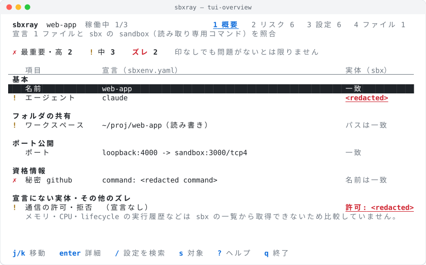
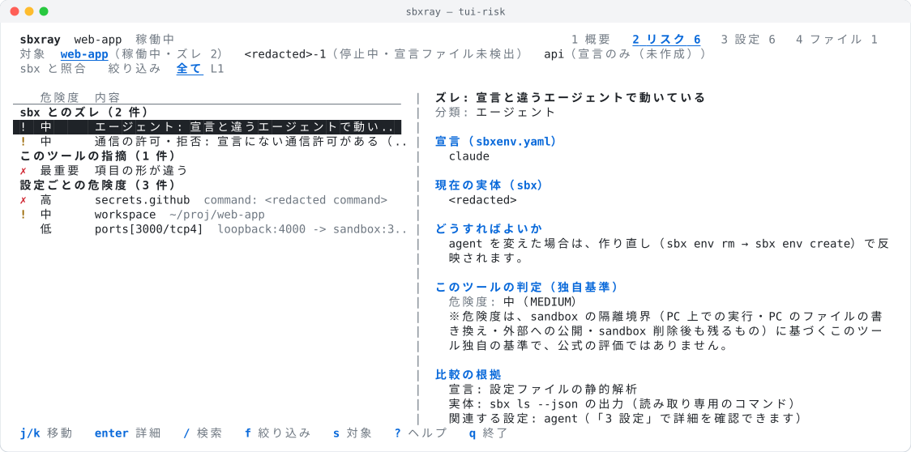

<div align="center">

# sbxray

**Docker Sandboxes（`sbxenv.yaml`）の X 線検査ツール**<br>
sandbox を起動する前に、最終設定・セキュリティ境界・出典・実体とのズレを可視化します。

[English](README.md) | **日本語**

[](https://github.com/kotarotaniguchi0523/sbxray/actions/workflows/ci.yml)
[](https://github.com/kotarotaniguchi0523/sbxray/releases)
[](go.mod)
[](.github/sbx-version)
[](LICENSE)

</div>

---

**sbxray** は、Docker Sandboxes（`sbx`）の環境ファイル `sbxenv*.yaml` とローカルの kit（`./kits/*`）を完全にオフラインで静的解析するツールです。sandbox を起動せず、Docker や `sbx` デーモンが止まっていても動作します。

- **レイヤー結合と出典の追跡** — 複数の `sbxenv*.yaml` を重ねた最終設定と、各値の `file:line`・kit 経路を可視化。
- **セキュリティ境界の分析** — ホスト実行・RW マウント・外向き通信・資格情報・SSH エージェント・ポート公開を一覧化。「安全」と誤認させる緑色は使いません。
- **稼働中 sandbox とのズレ検出** — 読み取り専用の `sbx` コマンドだけで実体と比較。シークレットの値は一切取得しません。
- **単一静的バイナリ** — 対話 TUI、テキスト、値を厳しく伏せた JSON（`--json`）で出力。

<picture>
  <source media="(prefers-color-scheme: dark)" srcset="docs/images/tui-overview-dark.svg">
  
</picture>

<picture>
  <source media="(prefers-color-scheme: dark)" srcset="docs/images/tui-risk-dark.svg">
  
</picture>

> [!NOTE]
> **`sbx` v0.54.0** を前提としています（[`.github/sbx-version`](.github/sbx-version)）。静的解析の範囲外（リモート kit、`:dev` テンプレート、ホスト共通ポリシー、未知の capability）は `--text` / `--json` の **Coverage** に毎回出力され、TUI では `4 ファイル` に `未展開` として表示されます。

## インストール

### mise（おすすめ）

```sh
mise use -g packslip:github.com/kotarotaniguchi0523/sbxray
```

Sigstore keyless 署名（`packslip.sigstore.json`）とダイジェストを自動で検証します。署名者を最初から固定する場合:

```sh
packslip install github.com/kotarotaniguchi0523/sbxray --pin ps1_q5dhguvg3md2hsfxcizfdued7a
```

### Nix / Go / 手動ダウンロード

```sh
# Nix（macOS / Linux）
nix run github:kotarotaniguchi0523/sbxray -- --version

# Go
go install github.com/kotarotaniguchi0523/sbxray/cmd/sbxray@latest
```

macOS・Windows（`amd64` / `arm64`）向けの `tar.gz` アーカイブは [GitHub Releases](https://github.com/kotarotaniguchi0523/sbxray/releases) から取得できます（SHA-256 チェックサム・build provenance 付き）。

## 使い方

パスとフラグは `sbx env create` と同じ形式です。ディレクトリを渡すと `<dir>/sbxenv.yaml` を読み込み、右に並べたファイルほど優先されます。

```sh
# 対話 TUI を起動（./sbxenv.yaml・~/.sbxenv.yaml と稼働中 sandbox を自動検出）
sbxray

# 複数ファイルを重ねて解析（右が優先）
sbxray base.sbxenv.yaml local.sbxenv.yaml --env-arg workspace=./app

# CI 向け: 警告かエラーがあれば終了コード 1
sbxray . --text --fail-on=warning

# 値を厳しく伏せた JSON IR を出力
sbxray . --json > plan.json
```

| フラグ | 説明 |
|---|---|
| `--env-arg NAME=VALUE`, `--env-args-file FILE` | 環境引数（後ろのファイル・フラグが優先） |
| `--kit-arg [KIT.]NAME=VALUE`, `--kit-args-file FILE` | kit 引数の上書き |
| `--name`, `--clone[=true\|false]`, `--skip-host-commands` | `sbx env create` と同じ意味 |
| `--cloud`, `--ttl`, `--on-timeout` | `sbx --cloud` 制約で検証 |
| `--text` / `--json` | 出力形式（TTY では既定で TUI） |
| `--redact` | TUI・`--text` でも値を厳しく伏せる |
| `--live` / `--offline` | 読み取り専用 `sbx` 比較の強制有効化 / 無効化 |
| `--fail-on LEVEL` | `none` \| `warning` \| `error` \| `critical` \| `high` \| `medium` \| `low` |

終了コード: `0` 正常、`1` `--fail-on` 基準到達、`2` 引数誤りまたは解析失敗。

## TUI

| 画面 | 内容 |
|---|---|
| `1 概要` | 構成の申告書。ファイルの宣言と、稼働中なら `sbx` の実体を並べ、違うところに印を付ける |
| `2 リスク` | 診断・リスク項目・実体とのズレを深刻度順に表示 |
| `3 設定` | 全項目の一覧（`g` でレイヤー別 / 境界別 / kit 別に切り替え） |
| `4 ファイル` | 入力ファイルと kit の一覧（SHA-256・未展開リモートの表示） |

行の印は左端に 1 つだけです（`✗` 高、`!` 中）。境界の目印の一覧は詳細ペインに出ます。色は端末の 16 色だけを使うので明るい背景でも暗い背景でも読め、印は記号なので色がなくても意味が伝わります。

詳細ペインでは公式ドキュメントの見解、OWASP 等の外部基準、sbxray 独自の境界判定、上書き履歴、`file:line` の出典を日本語で表示します。マウス操作・`NO_COLOR` に対応しています。

| キー | 動作 |
|---|---|
| `1`–`4` / `[` `]` | 画面の切り替え |
| `j` `k` / `h` `l` | 移動 / ペイン切り替え |
| `Enter` / `Esc` | 詳細を開く / 戻る |
| `g` / `f` / `/` | まとめ方切り替え（`3 設定`）/ レイヤー絞り込み / 検索 |
| `<` `>` / `s` | 対象 sandbox 切り替え / 一覧から選択 |
| `?` / `q` | ヘルプ / 終了 |

## 稼働中 sandbox との比較と値の伏せ方

- **読み取り専用のライブ比較**: 引数なしで端末実行（または `--live` 指定）すると、読み取り専用の `sbx` コマンド（`ls` / `policy ls` / `secret ls` / `mcp ls` + `--json --no-input`）で実体を取得し、エージェント・マウント・ポート・通信ポリシー・シークレット登録・MCP のズレを表示します。シークレットの値は一切読み取りません。
- **厳格な値の伏せ方**: シークレットの値や URL 埋め込み認証情報は全モードで出力しません。`--json` と `--redact` では env 値・引数（展開先を含む）・コマンド本文・`op://` 詳細・URL パス/クエリも伏せ、`sbx` から読んだ値（名前・エージェント・パス・ポート・ホスト・シークレット名）も、伏せた引数を含みうるため `<redacted>` と表示します。ズレは種類ごとに残ります。制御文字・双方向制御文字は端末出力前にエスケープします。

## コーディングエージェント向け（内蔵 Skills）

`sbxray` はバイナリ内にバージョン一致のドキュメントとワークフローを内蔵しています（Web 検索不要）。

```sh
sbxray describe                 # コマンドとフラグの仕様を JSON で表示
sbxray skills list --json           # 内蔵スキルの一覧を表示
sbxray skills get core          # エージェント向け基本ワークフローと JSON ガイド
sbxray skills get core --full   # 全フラグのリファレンスも含めて出力
```

エージェント環境へ配置できる軽量スタブ [`skills/sbxray/SKILL.md`](skills/sbxray/SKILL.md) も同梱しています。

## 開発

```sh
mise install        # 版固定されたツールを導入
mise run lint       # gofmt, go vet, declscope
mise run test       # go test -race ./...
mise run e2e        # PTY での TUI テスト
```

設計の詳細は [`DESIGN.md`](DESIGN.md)、開発・エージェント向けルールは [`AGENTS.md`](AGENTS.md) を参照してください。

## ライセンス

[MIT](LICENSE)
