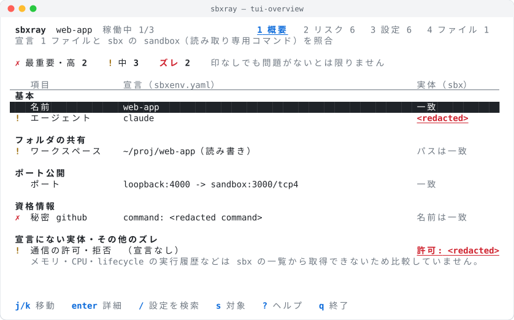
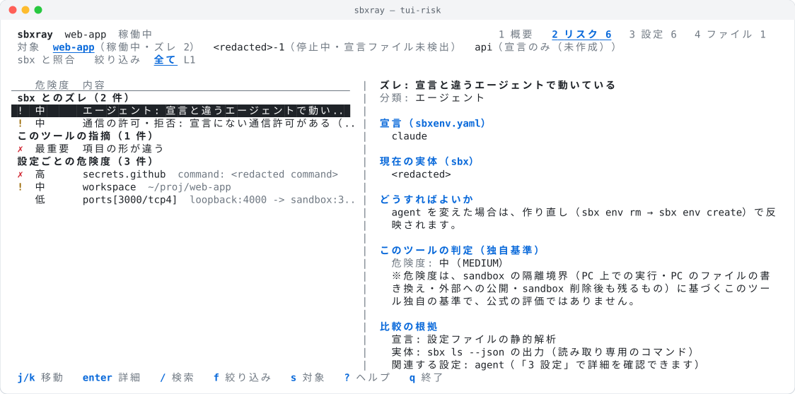

<div align="center">

# sbxray

**X-ray vision for Docker Sandboxes (`sbxenv.yaml`)**<br>
Inspect effective config, security boundaries, provenance, and live drift before you launch.

**English** | [日本語](README.ja.md)

[](https://github.com/kotarotaniguchi0523/sbxray/actions/workflows/ci.yml)
[](https://github.com/kotarotaniguchi0523/sbxray/releases)
[](go.mod)
[](.github/sbx-version)
[](LICENSE)

</div>

---

**sbxray** statically resolves layered Docker Sandboxes environment files (`sbxenv*.yaml`) and local kits (`./kits/*`) completely offline — no running sandbox, Docker, or `sbx` daemon required.

- **Layered resolution & provenance** — Merge `sbxenv*.yaml` layers and trace every value to its exact `file:line` and kit.
- **Security boundary analysis** — Surface host execution, writable mounts, outbound network rules, credentials, SSH agent forwarding, and exposed ports — without misleading "safe" green indicators.
- **Live drift detection** — Compare declarations against existing `sbx` sandboxes using read-only commands without ever reading secret values.
- **Single static binary** — Output as an interactive TUI, plain text, or strictly redacted JSON (`--json`).

<picture>
  <source media="(prefers-color-scheme: dark)" srcset="docs/images/tui-overview-dark.svg">
  
</picture>

<picture>
  <source media="(prefers-color-scheme: dark)" srcset="docs/images/tui-risk-dark.svg">
  
</picture>

> [!NOTE]
> Targets **`sbx` v0.54.0** ([`.github/sbx-version`](.github/sbx-version)). Items outside static analysis (remote kits, `:dev` templates, host-wide policies, unknown capabilities) are always reported under **Coverage** in `--text` / `--json`; those a file names (remote kits, `:dev` templates, unknown capabilities) are also marked `未展開` in `4 ファイル`, and the premises every run shares (host-wide policies, the built-in agent, stored secrets) are explained in the help (`?`).

## Installation

### mise (Recommended)

```sh
mise use -g packslip:github.com/kotarotaniguchi0523/sbxray
```

Verifies Sigstore keyless signatures (`packslip.sigstore.json`) and digests automatically. To pin the signer from the first install:

```sh
packslip install github.com/kotarotaniguchi0523/sbxray --pin ps1_q5dhguvg3md2hsfxcizfdued7a
```

### Nix / Go / Manual

```sh
# Nix (macOS / Linux)
nix run github:kotarotaniguchi0523/sbxray -- --version

# Go
go install github.com/kotarotaniguchi0523/sbxray/cmd/sbxray@latest
```

Pre-built `tar.gz` archives for macOS and Windows (`amd64` / `arm64`) are available on [GitHub Releases](https://github.com/kotarotaniguchi0523/sbxray/releases) with SHA-256 checksums and GitHub build provenance attestations.

## Usage

Paths and flags mirror `sbx env create`. Passing a directory reads `<dir>/sbxenv.yaml`; later files override earlier ones.

```sh
# Interactive TUI (auto-discovers ./sbxenv.yaml, ~/.sbxenv.yaml, and live sandboxes)
sbxray

# Layer multiple files (rightmost wins)
sbxray base.sbxenv.yaml local.sbxenv.yaml --env-arg workspace=./app

# CI gate: exit 1 if any warning or error is found
sbxray . --text --fail-on=warning

# Strictly redacted JSON IR
sbxray . --json > plan.json
```

| Flag | Description |
|---|---|
| `--env-arg NAME=VALUE`, `--env-args-file FILE` | Environment arguments (later files and flags win) |
| `--kit-arg [KIT.]NAME=VALUE`, `--kit-args-file FILE` | Override kit arguments |
| `--name`, `--clone[=true\|false]`, `--skip-host-commands` | Same as `sbx env create` |
| `--cloud`, `--ttl`, `--on-timeout` | Validate against `sbx --cloud` constraints |
| `--text` / `--json` | Output format (defaults to TUI on a TTY) |
| `--redact` | Apply strict redaction to TUI and `--text` |
| `--live` / `--offline` | Force or disable read-only `sbx` live comparison |
| `--fail-on LEVEL` | `none` \| `warning` \| `error` \| `critical` \| `high` \| `medium` \| `low` |

Exit codes: `0` OK, `1` `--fail-on` threshold reached, `2` invalid arguments or parse error.

## Interactive TUI

| View | Description |
|---|---|
| `1 概要` (Overview) | A manifest of the configuration: what the files declare and, with live data, what `sbx` actually has, stamped where they differ |
| `2 リスク` (Risk) | Live drift, then diagnostics, then risky items, each section sorted by severity |
| `3 設定` (Items) | All resolved items (`g` toggles grouping by Layer / Boundary / Kit) |
| `4 ファイル` (Sources) | Input files and kits with SHA-256 digests and unexpanded remote markers |

Rows carry at most one mark in the left margin (`✗` high, `!` medium); the full list of boundary tags is in the detail pane. Colours are the terminal's own 16 ANSI colours, so light and dark themes both work, and every mark is a glyph, so nothing depends on colour.

Each detail pane shows official Docker Sandboxes docs, relevant OWASP references, and sbxray's boundary assessment (currently in Japanese), along with merge history and `file:line` provenance. Supports mouse navigation and `NO_COLOR`.

| Key | Action |
|---|---|
| `1`–`4` / `[` `]` | Switch view |
| `j` `k` / `h` `l` | Navigate items / switch panes |
| `Enter` / `Esc` | Open detail / go back |
| `g` / `f` / `/` | Group (`Items`) / filter by layer / search |
| `<` `>` / `s` | Switch target sandbox / sandbox picker |
| `?` / `q` | Help / quit |

## Live Drift & Redaction

- **Read-only live comparison**: When run with no arguments in a terminal (or with `--live`), `sbxray` runs read-only `sbx` list commands (`ls`, `policy ls`, `secret ls`, `mcp ls` with `--json --no-input`) to highlight drift across agents, mounts, ports, network policies, secrets, and MCP servers. Secret values are never read.
- **Strict redaction**: Secret values and embedded URL credentials are never emitted in any mode. `--json` and `--redact` also redact env values, arg values (including interpolated segments), command bodies, `op://` details, and URL paths/queries, and show every value `sbx` reports (names, agents, paths, ports, hosts, secret names) as `<redacted>`, since it can carry a hidden argument; each drift is still listed by kind. Control and BiDi characters are escaped before terminal output.

## For Coding Agents (Built-in Skills)

`sbxray` embeds version-matched documentation and workflows directly in the binary (no web search needed):

```sh
sbxray describe                 # CLI contract as JSON
sbxray skills list --json           # list built-in skills
sbxray skills get core          # core agent workflow & JSON output guide
sbxray skills get core --full   # include full flag reference
```

A lightweight discovery stub is also included at [`skills/sbxray/SKILL.md`](skills/sbxray/SKILL.md).

## Development

```sh
mise install        # install pinned tools
mise run lint       # gofmt, go vet, declscope
mise run test       # go test -race ./...
mise run e2e        # PTY TUI tests
```

See [`DESIGN.md`](DESIGN.md) for architecture details and [`AGENTS.md`](AGENTS.md) for contributor/agent rules.

## License

[MIT](LICENSE)
